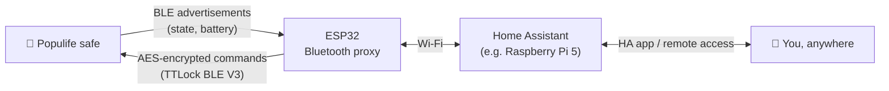
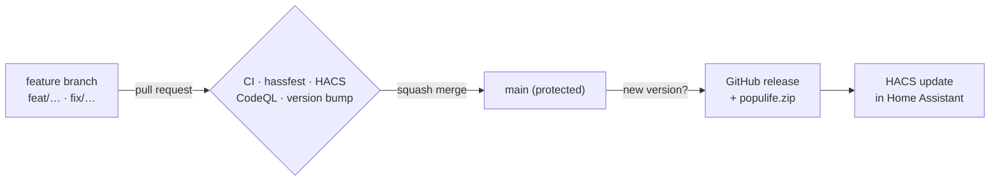

<p align="center">
  
</p>

<h1 align="center">Populife for Home Assistant</h1>

<p align="center">
  Local, cloud-free Bluetooth control of <b>Populife smart safes</b> and other Sciener / TTLock-based locks.
</p>

<p align="center">
  <a href="https://github.com/hacs/integration"></a>
  <a href="https://github.com/Antonio112009/ha-populife/releases"></a>
  <a href="https://github.com/Antonio112009/ha-populife/actions/workflows/ci.yml"></a>
  <a href="https://github.com/Antonio112009/ha-populife/actions/workflows/validate.yml"></a>
  
  
  <a href="LICENSE"></a>
</p>

---

Populife safes only offer remote control through the vendor app and a paid Wi-Fi gateway.
This integration lets **Home Assistant act as the gateway**. It talks to the safe directly over
Bluetooth, through the Raspberry Pi's built-in radio, a USB dongle or an
[ESPHome Bluetooth proxy](https://esphome.io/components/bluetooth_proxy/) placed next to the
safe. Remote access then goes through your Home Assistant instance.

> [!NOTE]
> This is a young, niche project. It is built on a well-tested protocol library, but the list
> of confirmed models is still short. If you own a Populife or TTLock device, a report in the
> [issues](https://github.com/Antonio112009/ha-populife/issues) (working or not) helps a lot.

## Highlights

- **Automatic discovery.** Home Assistant notices the safe as soon as it advertises; there is
  nothing to scan for by hand.
- **Fully local.** Lock and unlock run over Bluetooth; there is no cloud polling and no vendor
  gateway.
- **Passive state.** Bolt position and battery are read from the safe's advertisements, so no
  connection is held open and the battery lasts.
- **Proxy friendly.** A command connects through the adapter or ESPHome proxy with the best
  signal, then disconnects after 15 s of inactivity to free the proxy slot.
- **Secure by design.** Your cloud password is never stored, and the safe's key is redacted
  from diagnostics.
- **Modern stack.** Built for Home Assistant 2026.10 on Python 3.14, with strict typing, about
  99% test coverage, and hassfest, HACS and CodeQL checks on every commit.

## How it works



Populife hardware runs Sciener/TTLock firmware. The integration speaks its **TTLock BLE V3**
protocol through the MIT-licensed [`ttlock-ble`](https://github.com/roquerodrigo/ttlock-ble)
library:

| Layer | What happens |
| --- | --- |
| Discovery | The safe advertises GATT service `0x1910`; Home Assistant matches it and offers setup. |
| State | Manufacturer data in every advertisement carries the bolt bit, battery level and MAC address. |
| Transport | Commands are written to characteristic `0xFFF2`; replies arrive as notifications on `0xFFF4`. |
| Security | Every frame is AES-128 encrypted with the safe's own key. Unlocking needs a one-time token from the safe (`CHECK_USER_TIME`) plus the unlock key. |

Anyone in range can *see* a safe, but only the holder of its key can open it.

## Entities

| Entity | Description |
| --- | --- |
| `lock.<safe>` | Lock / unlock. Shows `locking` / `unlocking` while a command runs. |
| `sensor.<safe>_battery` | Battery level (diagnostic). |
| `sensor.<safe>_signal_strength` | RSSI in dBm (diagnostic, disabled by default). |
| `sensor.<safe>_last_unlock` | When the safe was last opened, from its own operation log. |
| `sensor.<safe>_last_unlock_method` | How it was opened: app, keypad, fingerprint, card, mechanical key, gateway or remote. |
| `event.<safe>_operation` | Fires for every new operation-log record, typed by method (also `failed` and `alarm`). Shows in the device's **Activity**. |

The safe keeps its own operation log, and its advertisements say when there are new records.
Home Assistant then connects briefly and reads them, so openings that happened while Home
Assistant was offline still appear. Keypad codes are never put into events or attributes;
only fingerprint and card IDs are.

After a restart, Home Assistant connects once to read the bolt state, battery, admin settings
and new log records. Model, firmware, hardware revision and serial number are stored on the
device. A battery below 20% raises a **Repairs** issue that clears again from 25%.

With an **admin key** (the owner's key, or a manual key that includes the Bluetooth admin
password) you also get:

| Entity | Description |
| --- | --- |
| `number.<safe>_auto_lock_delay` | Seconds before the safe re-locks itself; `0` turns auto-lock off. |
| `switch.<safe>_lock_sound` | Keypad and bolt beep. |
| `button.<safe>_sync_clock` | Set the safe's clock to Home Assistant's local time. |

These settings are read right after startup, or on demand with `homeassistant.update_entity`.

### Keypad passcodes (admin key)

| Action | What it does |
| --- | --- |
| `populife.add_passcode` | Add a 4–9 digit code: permanent, or valid between `start` and `end`. |
| `populife.delete_passcode` | Remove a code. |
| `populife.clear_passcodes` | Remove **every** code, including ones made in the app. There's no undo. |
| `populife.list_passcodes` | Return the codes the safe reports (response data). |

```yaml
# A code for a guest that works only this weekend
action: populife.add_passcode
target:
  entity_id: lock.office_safe
data:
  code: "482916"
  start: "2026-11-07 09:00:00"
  end: "2026-11-08 20:00:00"
```

The safe only lists codes made in the app after they've been used once.

## Requirements

- Home Assistant **2026.10** or newer.
- A Bluetooth radio within range of the safe, usually a few metres through walls:
  - the built-in Bluetooth of a Raspberry Pi or other host,
  - a USB Bluetooth adapter, or
  - an [ESPHome Bluetooth proxy](https://esphome.io/components/bluetooth_proxy/). This is the
    best option when Home Assistant runs far from the safe; any ESP32 board works.
- The safe paired in the Populife (or TTLock) app, so that it has a key.

## Installation

### HACS (recommended)

[](https://my.home-assistant.io/redirect/hacs_repository/?owner=Antonio112009&repository=ha-populife&category=integration)

Or manually: **HACS → ⋮ → Custom repositories**, add
`https://github.com/Antonio112009/ha-populife` as an **Integration**, install **Populife**, then
restart Home Assistant.

### Manual

Download `populife.zip` from the [latest release](https://github.com/Antonio112009/ha-populife/releases/latest),
extract it into `config/custom_components/populife/`, and restart Home Assistant.

## Setup

[](https://my.home-assistant.io/redirect/config_flow_start/?domain=populife)

1. Touch the safe's keypad to wake it. Home Assistant shows **Discovered: S…_xxxxxx** under
   **Settings → Devices & services**. You can also click the button above to pick the safe
   from the list.
2. Choose how to provide the key:
   - **Import from account.** Sign in once. Home Assistant downloads this safe's key and
     discards your password. On first use the cloud emails a verification code. This works
     for accounts on the shared TTLock servers. Populife accounts live on Populife's own
     servers and are rejected here, so use one of the next two options.
   - **Paste lock data.** Paste the lock details JSON from the app's sync response, for
     example as a proxy app on your phone shows it. Home Assistant reads the AES key, unlock
     key, admin password, flag position and firmware ids (`groupId` / `orgId`) from it.
   - **Enter manually.** Fill in the AES key (16 hex bytes) and the unlock key, either as
     digits or as the encoded `lockKey`. Optionally add the admin password, flag position,
     group ID and org ID.

   Home Assistant connects to the safe once to check the key before saving. If the safe isn't
   in range yet, setup offers **Scan again**.

> [!IMPORTANT]
> The **Admin code** shown in the Populife app is the keypad passcode, not the Bluetooth admin
> password. Do not enter it in the manual form.

If the safe later rejects the key (revoked, or the safe was reset), Home Assistant asks you to
re-authenticate. To swap the key yourself, use **Reconfigure** on the integration entry.

## Troubleshooting

| Symptom | Fix |
| --- | --- |
| Safe is not discovered | Touch the keypad, then move a Bluetooth proxy closer. Check **Settings → System → Bluetooth** to see whether any adapter hears it. |
| `No connectable Bluetooth adapter or proxy can reach …` | The safe was heard only by a passive scanner. Use a proxy with `active: true` within range. |
| Lock state is `unknown` | No advertisement has arrived since restart yet. Wake the safe once. |
| Login fails during import | Use **Enter manually**, or open an issue with the error text. |

For logs, add this to `configuration.yaml`:

```yaml
logger:
  logs:
    custom_components.populife: debug
    ttlock_ble: debug
```

## Roadmap

- [x] Bluetooth discovery, lock / unlock, battery and signal sensors
- [x] Cloud key import and manual key entry, reauth and reconfigure
- [x] Admin settings: auto-lock delay, lock sound, clock sync
- [x] Operation-log events
- [x] "Scan again" in setup when no safe is in range yet
- [x] Paste lock data copied from the app
- [x] Keypad passcode actions (add, delete, clear, list)
- [x] Operation log import with last-unlock sensors, even for openings while offline
- [x] State, device info and settings read after startup
- [x] Low-battery repair issue
- [ ] Optional [Populife Open API](https://open.populife.co/doc/index_en.html) support:
      create one-time and time-limited PIN codes from automations, and import the unlock history
- [ ] Confirmed-models list and device-specific quirks
- [ ] Submission to the HACS default repository

## Development

```bash
uv sync
uv run pre-commit install
uv run pytest
```

| Check | Tooling |
| --- | --- |
| Lint and format | [ruff](https://docs.astral.sh/ruff/) with every rule enabled |
| Types | mypy `--strict` |
| Tests | `pytest-homeassistant-custom-component`, 90% coverage floor |
| Home Assistant | [hassfest](https://developers.home-assistant.io/blog/2020/04/16/hassfest/) |
| HACS | [hacs/action](https://github.com/hacs/action) |
| Security | CodeQL |
| Version bump | PRs that change the integration must raise the manifest version |

### Trunk-based workflow



1. Branch off `main`, make the change and open a pull request. Direct pushes to `main` are
   blocked.
2. If the PR changes `custom_components/` or `hacs.json`, bump the version (semver):

   ```bash
   uv run python scripts/bump_version.py patch   # or minor / major / X.Y.Z
   ```

   In VS Code: **Terminal → Run Task → Bump version**. In Claude Code: `/bump-version`.
3. Once every check is green, squash-merge. The release workflow publishes `vX.Y.Z` with
   `populife.zip`, and HACS offers it as an update. Merges that keep the version (docs, CI,
   dev dependencies) publish nothing.

## Credits

- [`ttlock-ble`](https://github.com/roquerodrigo/ttlock-ble): the async TTLock BLE V3 library
  this integration is built on.
- The Home Assistant community's TTLock reverse-engineering work.

## Disclaimer

This project is not affiliated with, endorsed by, or supported by Populife, Sciener or TTLock.
The protocol is reverse-engineered and could break with a firmware update. Use it at your own
risk, and keep a physical way into your safe.

## License

[MIT](LICENSE)
